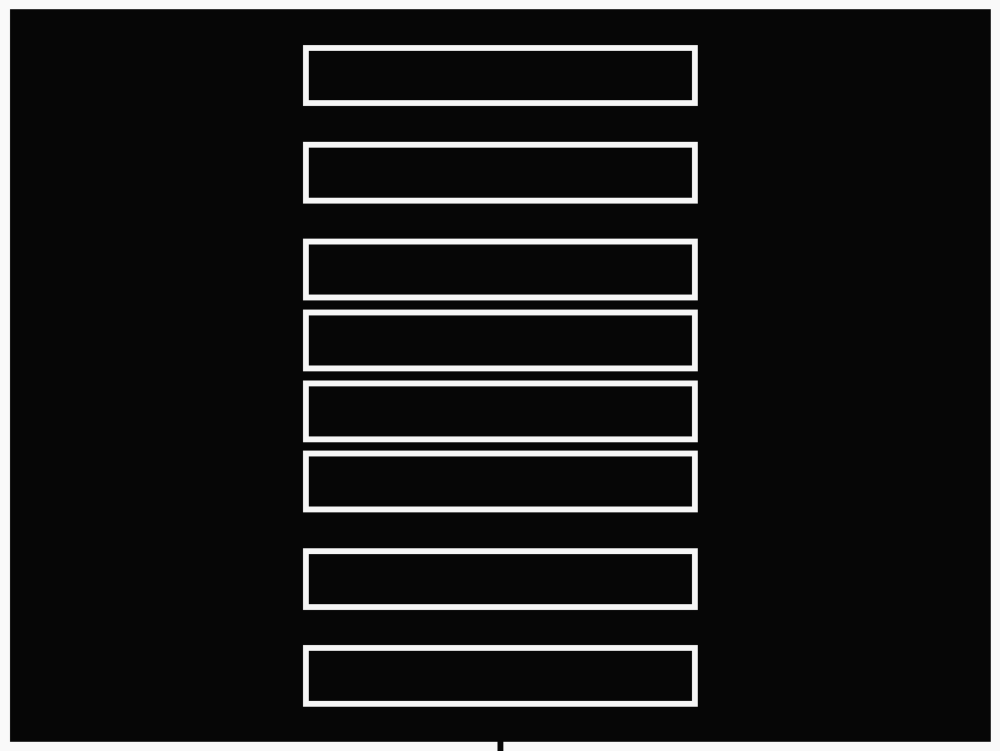

# CSS

Things I want to remember about CSS.

<details><summary><h2>Contents</h2></summary>

<!-- toc -->

- [Stack](#stack)
  * [Nested Stack](#nested-stack)
- [Responsive grid](#responsive-grid)
- [Center aligned icons](#center-aligned-icons)
- [Development](#development)
  * [Local Dev Server](#local-dev-server)
  * [Lint](#lint)
  * [Build](#build)

<!-- tocstop -->

</details>

## Stack

[The stack](./src/stack.css) provides the `.stack` class, based on
[every-layout.dev stack](https://every-layout.dev/layouts/stack/).
It removes block margins from direct children and adds space between
adjacent children, with no extra space at either end.

```html
<div class="stack">
  <h2>Heading</h2>
  <p>First paragraph.</p>
  <p>Second paragraph.</p>
</div>
```

Set `--stack-space` on the stack to change the spacing (default `1.5rem`).
Nested stacks can set their own spacing; the property otherwise inherits
from an ancestor. Children need to participate in block layout for block
margins to create space.

### Nested Stack

Use `stack-large` and `stack-small` alongside `stack` to give nested
groups different spacing:

```html
<div class="stack stack-large">
  <section class="stack stack-small">
    <h2>First section</h2>
    <p>Items in this section are close together.</p>
  </section>
  <section class="stack stack-small">
    <h2>Second section</h2>
    <p>Sections are farther apart than their contents.</p>
  </section>
</div>
```

The outer stack spaces its sections by `3rem`; each nested stack spaces
its own children by `0.5rem`. The variant classes use fixed values, so
changing `--stack-space` does not change their spacing. Use `.stack`
without a variant for configurable spacing. If a nested child sets
`--stack-space`, that value also affects its own margin when its parent
uses the configurable `.stack` rule.

See also
[nested variants](https://every-layout.dev/layouts/stack/#nested-variants).



---

## Responsive grid

[`src/responsive-grid.css`](./src/responsive-grid.css) provides the
`.smol-css-grid` class. It creates as many columns as fit, with a minimum
width of `15ch` and a `1rem` gap. Columns shrink to the container width
when it's narrower than the minimum.

```html
<div class="smol-css-grid">
  <div>One</div>
  <div>Two</div>
  <div>Three</div>
</div>
```

Override `--min` and `--gap` on the grid to change the column width and
spacing.

## Center aligned icons

[`src/center-icon.css`](./src/center-icon.css) provides the `.center`
class. Its first child is the icon; subsequent content is the label. The
icon aligns with the first line of text, including when the label wraps.

```html
<div class="center">
  <svg aria-hidden="true"><!-- Icon --></svg>
  <span>Label</span>
</div>
```

Set `--size` on the container to change the icon size (default `1em`).
`--py` controls block padding (default `0.5em`); `--px` controls inline
padding and the gap, calculated from `--py`, line height, and cap height
by default. The technique was shared
[on Bluesky](https://bsky.app/profile/haz.dev/post/3n33ozvhwes2b).

## Development

### Local Dev Server

Serve the example page locally at `:8888`.

```sh
npm start
```

### Lint

```sh
npm run stylelint
```

### Build

Build the CSS to standard and minified versions in `dist/`.

```sh
npm run build
```
